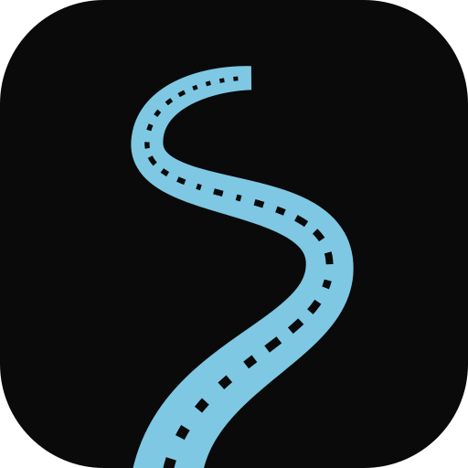

<p align="center">
  
</p>

<h1 align="center">Countersteer</h1>

<p align="center">
  Motorcycle navigation for handlebar-mounted phones, built to be used with gloves on.<br>
  It plans curvy, scenic, or quick routes, then guides you turn by turn.
</p>

---

> **Status:** early alpha (v0.1.0). It's a personal project that I ride with, not a published app.

## Features

- **Three route types for every trip.** *Curvy* (scored on how much the bearing changes along the route), *Scenic* (maneuver density plus named-road ratio), and *Quickest* (Valhalla travel time adjusted with live TomTom traffic).
- **Explore mode.** Pick a direction and a distance, and the app builds a round trip that brings you home.
- **Destination mode.** Search for a place (Nominatim) and get A-to-B options.
- **Turn-by-turn navigation.** Smoothed bearing and speed, segment-aware ETA, automatic rerouting that rejoins your original route instead of cutting it short, and auto-end on arrival.
- **Live traffic.** TomTom re-queries every 5 minutes and whenever your pace drifts more than 20%.
- **Speed and red-light camera alerts** from OpenStreetMap data (Overpass).
- **Ride logging.** A foreground service records every ride, with history, stats, and a summary afterwards. Any past ride can become a return trip.
- **Offline maps, saved routes, favourite places, and road markers.**
- **Backup and restore** to a single ZIP file.

## Designed for riding

Phones on handlebars get used at speed, in sunlight, with gloves on. So the UI follows a few strict rules:

- **80dp minimum touch targets**, with 96dp in riding mode and 28dp gaps between controls.
- **Dark theme only**, with fixed safety colours (red, amber, green) that never change with dynamic colour.
- **14sp minimum text size.** Metric units only.
- **Context-aware components.** `LocalRidingContext` makes controls larger and animations faster during navigation.
- **Accessibility built in.** Live regions for speed, turns, and alerts; content descriptions on every icon.

## Tech stack

| Area | Choice |
|---|---|
| UI | Jetpack Compose, Material 3 |
| Architecture | MVVM, `StateFlow`, Hilt |
| Persistence | Room (with explicit migrations and exported schemas) |
| Networking | Ktor (OkHttp engine) + kotlinx.serialization |
| Maps | MapLibre with [OpenFreeMap](https://openfreemap.org) tiles |
| Routing | [Valhalla](https://github.com/valhalla/valhalla) |
| Traffic | TomTom Traffic Flow API (optional, bring your own key) |
| Geocoding / POIs | Nominatim, Overpass |
| Location | Fused Location Provider |

Requires Android 12+ (min SDK 31, target SDK 35).

### Project layout

```
com.countersteer/
├── alerts/       Camera alerts (Overpass)
├── app/          Application + MainActivity
├── data/         Room entities, DAOs, repositories, backup, offline maps, location
├── logging/      Ride recording service and stats
├── navigation/   Turn-by-turn engine and navigation state
├── onboarding/   First-launch flow
├── routing/      Route generation, scoring, and API clients
└── ui/           Screens, components, and the design system
```

Route scoring is explained in [docs/ROUTE-TYPES.md](docs/ROUTE-TYPES.md).

## Building

You need Android Studio (or JDK 17+) and the Android SDK.

```bash
./gradlew assembleDebug     # build
./gradlew installDebug      # build and install on a connected device
```

## API keys

**Nothing secret lives in this repository.** The app works out of the box with free, keyless services (Valhalla, Nominatim, Overpass, OpenFreeMap).

Live traffic is optional and uses your own TomTom key. You enter it during onboarding or later in **Settings → API Keys**, and it's stored on the device in encrypted preferences. It's never compiled into the app. See [docs/TOMTOM-API-SETUP.md](docs/TOMTOM-API-SETUP.md) to get a free key.

## Third-party services

Countersteer calls public community-run services. Please respect their usage policies:

- Routing: the [FOSSGIS Valhalla instance](https://valhalla1.openstreetmap.de) (fair use; host your own for heavy use)
- Geocoding: [Nominatim usage policy](https://operations.osmfoundation.org/policies/nominatim/) (max 1 request per second; the app debounces search)
- POIs: [Overpass API](https://wiki.openstreetmap.org/wiki/Overpass_API)
- Map data © [OpenStreetMap contributors](https://www.openstreetmap.org/copyright)

## License

[Apache 2.0](LICENSE)
